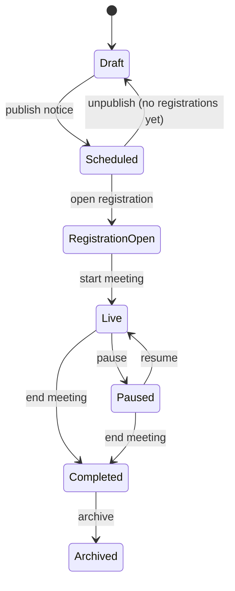

# AGM/EGM Workflow

Implementation phases: meeting management in C, live features in D, voting in E. The rules below are the design contract.

## 1. Meeting lifecycle



| Transition | Who | Guards |
|---|---|---|
| Draft to Scheduled | Company Admin | Title, schedule, record date, at least one agenda item, and notice text present. Rules validated. |
| Scheduled to Draft | Company Admin | No participant registrations yet. |
| Scheduled to Registration Open | Company Admin or Meeting Admin | Record-date snapshot taken and entitlements generated. |
| Registration Open to Live | Meeting Admin | Video room ready, or the meeting is configured as in-person only. |
| Live and Paused | Meeting Admin | Pausing freezes stage activation but keeps open voting sessions open unless the admin closes them. |
| Live or Paused to Completed | Meeting Admin | Every voting session closed. Confirmation required. |
| Completed to Archived | Company Admin | Minutes recorded. |

The API holds the state machine in `meetings/meeting-state.ts` as a pure transition table with unit tests. Each transition is a single transaction: a conditional update on the expected current state, an insert into `meeting_state_transitions`, and an audit record. Any other request returns `409 Conflict`. Concurrent transitions therefore cannot both succeed.

## 2. Agenda stage controls

Each agenda item has four independently controlled stages. **All start closed.** Only a Meeting Admin opens them, and only while the meeting is Live.

| Stage | Opens when | Closes when |
|---|---|---|
| Proposed | Admin opens it | Admin closes it, or the first valid proposal is accepted (first-accepted-only mode) |
| Seconded | Admin opens it, usually after a proposal is accepted | As above |
| Poll demand | Admin enables it and the rules allow poll demands for this resolution | Admin closes it |
| Voting | Admin opens the voting session | Admin closes it, or the configured deadline passes |

The shareholder room shows every stage control. Only open stages are enabled, and closed stages read "Not open yet" so the meeting is predictable.

## 3. Proposed and seconded

```
POST /meetings/:id/agendas/:agendaId/proposal    (Idempotency-Key header)
```

1. Check that the meeting is Live, the proposal stage is open, the caller has `proposal.submit`, and the caller holds an active entitlement for this meeting. The rules may also require a minimum holding.
2. In first-accepted-only mode: `INSERT INTO proposals (...) ON CONFLICT (agenda_id) WHERE status='ACCEPTED' DO NOTHING`. A partial unique index on accepted proposals guarantees one winner. Losers get `409` with "A proposal has already been accepted".
3. In collect-all mode, every valid submission is recorded and the admin accepts one.
4. Record the shareholder identity, entitlement, timestamp, request id and an audit event. Broadcast `agenda.proposal.accepted` to the meeting room.
5. Apply the configured close behaviour.

Seconding follows the same flow. It can also enforce that the seconder is not the proposer, which is configurable.

## 4. Poll demand

- Admin-enabled per resolution. One demand per entitlement, enforced by a unique index on `(agenda_id, entitlement_id)`.
- The response and the staff view show the demand count and the aggregate holding of demanders.
- **No threshold is hard-coded.** The rules say whether a threshold applies and how it is measured: by count of members, by percentage of voting rights, or as "any member". The system reports whether it is met and the chair or admin decides. See `VOTING_RULES.md`.

## 5. Questions and moderation

1. A shareholder submits text (Bangla or English, up to 2,000 characters) or audio (up to the configured 120 to 180 seconds). The upload goes to private object storage through a short-lived pre-signed URL. The server checks type, size and duration.
2. The question starts as Pending and is visible to moderators only.
3. A moderator approves, rejects with a reason, or forwards it to the board. Every action is a `moderation_actions` row and an audit event.
4. Board members see forwarded questions. Publishing to all participants is a separate, optional action.
5. Submitters see their own question status.

## 6. Attendance

Join and leave events come from the authenticated meeting-room connection and from video provider webhooks where available. Each is linked to a participant and, through them, to entitlements. Live counts cover participants present and the holdings represented. Attendance reports compute present-at-time and the total holding represented.

## 7. Real-time events

| Event | Room | Payload |
|---|---|---|
| `meeting.state` | meeting | `{ state, version }` |
| `agenda.active` | meeting | `{ agendaId, version }` |
| `agenda.stage` | meeting | `{ agendaId, stage, open, version }` |
| `voting.session` | meeting | `{ sessionId, open, closesAt }` |
| `attendance.count` | staff, board | `{ present, holdingRepresented }` |
| `announcement` | meeting | `{ id }` |
| `question.new` | moderators | `{ id }` |
| `question.forwarded` | board | `{ id }` |
| `results.released` | meeting | `{ sessionId }` |

Payloads are pointers. Clients fetch the authoritative state over REST.
