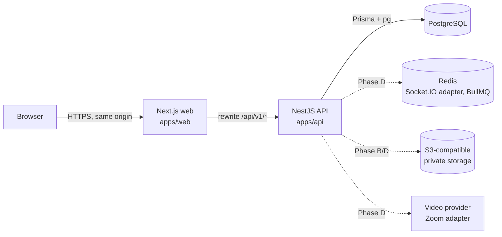

# Architecture

## 1. Shape

A **modular monolith**: one deployable API, one web app, and shared packages. Module boundaries are folders with explicit service interfaces, not network hops. Microservices are deliberately avoided until a module has a real independent scaling or ownership need.



- The browser talks only to the web origin. Next.js rewrites `/api/v1/*` to the API, so the session cookie is first-party and `SameSite=Lax` holds.
- The API is the only component that talks to the database.

## 2. Technology

| Concern | Choice | Version | Notes |
|---|---|---|---|
| Runtime | Node.js | 24 | |
| Package manager | pnpm workspaces | 12.11 | Build scripts are allow-listed in `pnpm-workspace.yaml` |
| API | NestJS | 12.3 | ESM-only release. Compiled with `tsc`. Tests use SWC for decorator metadata |
| ORM | Prisma | 7.10 | `prisma-client` generator with the `@prisma/adapter-pg` driver adapter and `prisma.config.ts`. Prisma 8 was still a release candidate at setup |
| Database | PostgreSQL | 18 (dev) | 16 or newer supported |
| Web | Next.js App Router, React | 16.4, 19.3 | `proxy.ts` (the former middleware) for a coarse route gate |
| Styling | Tailwind CSS | 4.3 | Tokens via `@theme` in `@irm/ui` |
| UI primitives | Radix UI (`radix-ui`) using the shadcn pattern | 1.8 | Components owned in `packages/ui` |
| Data fetching | TanStack Query | 5 | |
| Tables | TanStack Table | 8.21 | v9 is a new API. Pinned to v8 until we migrate deliberately |
| Forms | React Hook Form with Zod 4 | 7.91, 4.6 | Schemas shared with the API |
| Tests | Vitest 5, Supertest, Playwright 1.64 | | |

Planned for later phases: Socket.IO with the Redis adapter for real-time, BullMQ for imports and reports, S3-compatible object storage, and the Zoom Meeting SDK through the video adapter.

## 3. API modules

```
apps/api/src/
  config/            env validation (zod), fails fast at boot
  prisma/            PrismaService (global)
  common/            decorators (@Public, @SkipCsrf, @Principal, @Meta), exception filter, zod parsing
  modules/
    auth/            sessions, password hashing, AuthGuard (origin, session, CSRF)
    access/          AccessService: permission checks and isolation filters
    audit/           AuditService: append-only records, transactional
    tenancy/         tenants and companies
    identity/        users, role catalogue, role assignment
    dashboard/       scoped summary and audit reader
    health/
    # Phase B+: shareholders/, meetings/, voting/, communication/, video/, reports/
```

Module rules:
- Controllers parse input with shared Zod schemas, call `AccessService` before touching data, and write audit records inside the same transaction as the change.
- Voting logic lives only in the `voting` module, never in controllers of other modules or in the frontend.
- Future IRM modules (investor CRM, dividends) depend on the core entities (tenant, company, shareholder, shareholding) and never on meeting internals.

## 4. Request lifecycle

1. Express middleware runs in this order: helmet, cookie-parser, request id, JSON body limited to 1 MB.
2. `ThrottlerGuard` applies global and per-route limits. Login allows 10 requests per minute per IP.
3. `AuthGuard`:
   - Rejects state-changing requests whose `Origin` is not the web origin.
   - Lets `@Public` routes through.
   - Validates the session cookie against the hashed token, with absolute and idle expiry.
   - Requires `X-CSRF-Token` on state-changing requests. The token is an HMAC of the session token.
   - Loads active role assignments and their permissions onto `req.principal`.
4. The controller calls `AccessService.assert` or `assertCompany`, or uses a `*Filter` helper for list queries.
5. `HttpExceptionFilter` normalises errors and hides internals. It logs unknown errors with the request id.

## 5. Authorization model

- `@irm/shared` holds the permission catalogue, role definitions, `hasPermission` and `canAssignRole`. The API enforces them and the web uses the same functions to hide controls.
- Scope resolution happens server-side from database rows. A company's tenant is looked up and never trusted from the client.
- See `ROLES_AND_PERMISSIONS.md` for the matrix.

## 6. Frontend

- `app/login` is public. `app/(app)/*` is the signed-in shell. Its layout loads `/auth/me`, stores the CSRF token in memory, and provides the session context.
- `proxy.ts` redirects requests without a session cookie to `/login`. This is a UX shortcut. The API is the real gate.
- Data access goes through `lib/api.ts`, which adds the CSRF header, normalises errors and redirects on 401.

## 7. Real-time design (Phase D)

- Socket.IO namespaces per module. Connections are authenticated with the same session cookie during the handshake.
- Rooms: `meeting:{id}` (all participants), `meeting:{id}:staff`, `meeting:{id}:board`, `meeting:{id}:moderators`. Joining a room requires the matching permission and meeting participation.
- Events carry ids and versions, not authoritative state. Clients refetch from REST on reconnect or a version gap.
- The Redis adapter supports horizontal scaling.

## 8. Video design (Phase D)

A `VideoProvider` interface provides `createMeeting`, `issueJoinToken(user, role)`, `endMeeting` and `getStatus`. The `ZoomProvider` uses server-side credentials and signs Meeting SDK JWTs on the API. A `DevSimulatorProvider` is enabled only when `NODE_ENV=development` and no credentials exist. Its UI is labelled "Simulated video (development)".
