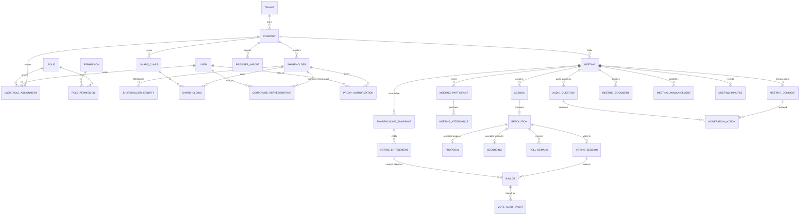

# Database

PostgreSQL with Prisma 7. Schema: `apps/api/prisma/schema.prisma`. Migrations: `apps/api/prisma/migrations`.

**Conventions.** UUIDv7 primary keys, which are time-ordered and index-friendly. snake_case tables and columns. `timestamptz(3)` timestamps. Every company-owned row carries both `tenant_id` and `company_id`. A composite foreign key to `companies(id, tenant_id)` makes the pair consistent at the database level.

## 1. Implemented in Phase A

| Table | Purpose | Key constraints |
|---|---|---|
| `tenants` | Corporate group | `slug` unique |
| `companies` | Legal entity holding meetings | `(tenant_id, slug)` unique; `(id, tenant_id)` unique as a composite FK target |
| `users` | Login identity (global) | `email` unique and lower-case (CHECK) |
| `roles` | System role catalogue, synced from `@irm/shared` | `key` unique |
| `permissions` | Permission catalogue | `key` unique |
| `role_permissions` | Role to permission | PK `(role_id, permission_id)` |
| `user_role_assignments` | Grants a role at a scope | CHECK on scope shape; FK `(company_id, tenant_id)` to companies; partial unique index on active assignments |
| `sessions` | Server sessions | `token_hash` unique (SHA-256), expiry index |
| `audit_logs` | Append-only audit trail | Triggers block UPDATE, DELETE and TRUNCATE |

Hand-written SQL lives in the `init_foundation` migration, appended after the Prisma-generated DDL:

```sql
-- Scope shape: PLATFORM has no ids, TENANT has a tenant only, COMPANY has both
CHECK ((scope='PLATFORM' AND tenant_id IS NULL AND company_id IS NULL) OR ...)
-- Company assignment tenant must equal the company's tenant
FOREIGN KEY (company_id, tenant_id) REFERENCES companies(id, tenant_id)
-- One active assignment per (user, role, scope, tenant, company)
CREATE UNIQUE INDEX ... WHERE revoked_at IS NULL
-- Audit log is append-only
CREATE TRIGGER audit_logs_no_update BEFORE UPDATE OR DELETE ON audit_logs ...
```

Integration tests cover each of these constraints.

## 1a. Implemented in Phase B

Tables: `share_classes`, `shareholders`, `shareholder_identities`, `shareholder_contacts`, `shareholdings`, `register_imports`, `register_import_rows`, `stored_files`, `corporate_representatives`, `proxy_authorizations` and `participant_links`. Also `otp_challenges` and `dev_outbox_messages`, which are not company-scoped. Users gained `kind` (STAFF or PARTICIPANT), a nullable `email` for participants, and MFA columns.

Hand-written SQL in the `phase_b_shareholders` migration:

| Rule | Mechanism |
|---|---|
| Tenant and company agree on every company-owned row | Composite FK `(company_id, tenant_id)` to `companies(id, tenant_id)` on all 11 tables |
| One current holding per account and class | Partial unique index `WHERE valid_to IS NULL` |
| Holdings history is immutable | Trigger allows only closing a current row. Other updates and all deletes are rejected. |
| No negative holdings; valid date ranges | CHECK constraints |
| One active copy of a contact | Partial unique index `WHERE retired_at IS NULL` |
| Participant links reference exactly one thing | CHECK by kind, plus partial unique indexes |
| Staff accounts have an email | CHECK `kind <> 'STAFF' OR email IS NOT NULL` |
| Row-level security | See below |

**Row-level security.** All 11 company-owned Phase B tables have RLS enabled. A policy for role `irm_app` allows only rows where `company_id = ANY(irm_company_ids())`, which parses the transaction setting `app.company_ids`. With no setting, no rows are visible. The API's `PrismaService.scoped(companyIds, fn)` opens a transaction, runs `SET LOCAL ROLE irm_app`, and sets `app.company_ids` before running `fn`. A mistaken or hand-written query inside that transaction cannot see or write another company's rows. The migration creates `irm_app` as a NOLOGIN role and grants it table privileges.

**Shares** are `bigint` and travel as strings in the API, because totals can exceed 2^53.

## 1b. Implemented in Phase C

Tables: `meetings`, `meeting_state_transitions`, `agenda_items`, `resolutions`, `meeting_documents`, `meeting_staff`, `shareholding_snapshots`, `voting_entitlements` and `meeting_participants`. `proxy_authorizations.meeting_id` is required by the API for new proxies.

| Rule | Mechanism |
|---|---|
| Every meeting child row belongs to the meeting's own company | Unique `(id, company_id)` on meetings, plus composite FKs `(meeting_id, company_id)` from all 8 child tables and from proxies |
| History, snapshots and entitlements are immutable | `irm_immutable_row()` trigger on update and delete |
| Hybrid meetings have a venue; snapshot quantities and weights are positive | CHECK constraints |
| Participant registration references match its kind | CHECK on `meeting_participants` |
| Row-level security | Same `irm_app` policy on all 9 new tables, giving 20 RLS tables in total |

**Record-date snapshot.** When a meeting moves to Registration Open, one SQL statement copies, for each account and share class, the holding row with the latest `as_of_date` on or before the record date, skipping zero balances and inactive holders. Voting entitlements are then created with `weight = quantity × votes_per_share` for classes that carry votes. Because closures write a zero-share row dated to the closing import, an account that left the register before the record date is correctly excluded.

## 2. Target model (Phases D to F)



### 2.1 Shareholder core (Phase B, reusable by future IRM modules)

| Entity | Notes |
|---|---|
| `share_classes` | Company share classes with `votes_per_share` and `voting` (bool). |
| `shareholders` | `type` is INDIVIDUAL or CORPORATE. Holds the name, and Bangla name where known, plus a status. Unique per company on the normalised primary identifier. |
| `shareholder_identities` | `kind` is BO_ID or FOLIO, with a `value` unique per `(company_id, kind, value)`. A corporate shareholder may hold many. |
| `shareholder_contacts` | Verified phone and email used for OTP. Has a `verified_at` and a source of either import or manual verification. |
| `shareholdings` | Current balance per identity and share class. Versioned: a register import closes the old row (`valid_to`) and opens a new one. Rows are never overwritten. |
| `register_imports` | File metadata, column mapping, counts, status, and the confirming user. Row-level errors go in `register_import_rows`. |
| `corporate_representatives` | Shareholder, user, covered identities, authorization document, `valid_from` and `valid_to`, approval by a company admin. |
| `proxy_authorizations` | Grantor shareholder, proxy user or person, meeting id (required), scope (attend only, or attend and vote), optional per-resolution instructions, `valid_until`, `revoked_at`, verification status and document. |

### 2.2 Meetings (Phase C)

| Entity | Notes |
|---|---|
| `meetings` | `type` (AGM or EGM), `state` (state machine), schedule, timezone, record date, the `rules` JSONB validated by a versioned schema (see `VOTING_RULES.md`), and the video provider reference. |
| `meeting_state_transitions` | Append-only history of who changed which state when. |
| `agendas` | Number, order, title, description, status, and stage flags (proposal, seconding, poll demand, voting) each with timestamps. |
| `resolutions` | Resolution text, kind (ordinary or special), and the required majority, taken from configuration. |
| `meeting_participants` | Links a user to a meeting with a capacity of SHAREHOLDER, CORPORATE_REP, PROXY, BOARD, MODERATOR or OFFICIAL, plus `entitlement_ids`. |
| `meeting_attendance` | Join and leave events with the client, IP and connection quality. |

### 2.3 Voting (Phase E)

| Entity | Notes |
|---|---|
| `shareholding_snapshots` | Frozen holdings at the record date. Immutable once the meeting goes Live, enforced by a trigger. |
| `voting_entitlements` | One row per (meeting, identity, share class) with a `weight`. Covers holders, corporate representatives and proxies through `exercisable_by_user_id`. |
| `voting_sessions` | One per resolution, with `opened_at`, `closes_at`, `closed_at`, the `allow_change` flag and the method. |
| `ballots` | `(voting_session_id, entitlement_id)` with a **partial unique index on the effective ballot** (`superseded_at IS NULL`), a choice, a weight snapshot, an `idempotency_key` unique per session, and the casting user. |
| `vote_audit_events` | Append-only: cast, superseded, rejected (with reason), and session opened, closed or released. Hash-chained per session (`prev_hash`, `hash`) so tampering is detectable. |
| `voting_results` | Tallies computed at closure and sealed until release. |

Ballot choices are readable only by the voting module's tally function and by a privileged-access grant. See `SECURITY.md`.

### 2.4 Communication (Phase D)

`meeting_comments` (text, language, status), `audio_questions` (object key, duration, mime, size, status), `moderation_actions` (append-only: approve, reject, forward, note), `meeting_announcements` and `meeting_documents` (object keys in private storage, checksum, uploader).

## 3. Isolation strategy

1. Every company-owned table has `tenant_id` and `company_id`, with a composite FK to `companies(id, tenant_id)`.
2. Every query goes through `AccessService` filters or assertions in the API layer.
3. PostgreSQL row-level security on shareholder tables, live since Phase B, with voting and communication tables to follow. It works through `prisma.scoped` and the `irm_app` role described above.

## 4. Migrations and seed

- Create migrations with `prisma migrate dev --create-only`, review and amend them (CHECKs, partial indexes, triggers), then apply with `prisma migrate deploy`.
- `prisma/seed.ts` always syncs the permission and role catalogue. It also adds demo tenants, companies and users when `NODE_ENV` is not `production`. It is idempotent.
- Tests rebuild the `*_test` database from migrations before each run and refuse any other database name.
